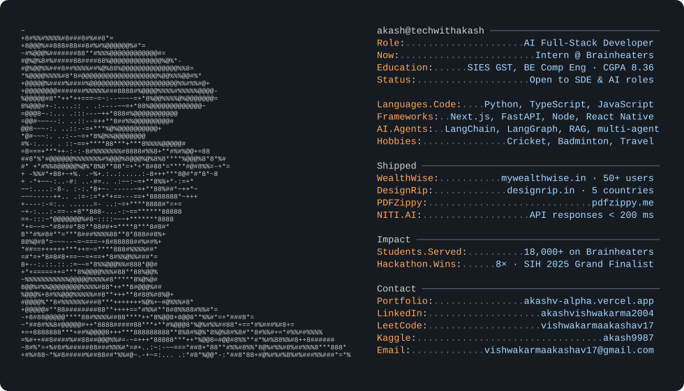

  <picture>
    <source media="(prefers-color-scheme: dark)" srcset="./assets/neofetch_dark.svg">
    <source media="(prefers-color-scheme: light)" srcset="./assets/neofetch_light.svg">
    
  </picture>

  
  
  
  
  

 

## Featured work

| Project | What it does | Proof |
| :-- | :-- | :-- |
| **[WealthWise](https://mywealthwise.in)** | AI budgeting, 10 languages | 50+ users · PitchCraft 2025 winner |
| **[DesignRip](https://designrip.in)** | Any website → `design.md` | Users in 5 countries |
| **NITI.AI** | Agentic legal-case insights | 6-node pipeline · &lt;200 ms API |
| **[PDFZippy](https://pdfzippy.me)** | 25 in-browser PDF tools + API | Free, no upload |
| **PRAMAN.AI** | Climate-displacement early warning | SIH 2025 Grand Finalist |
| **BloomAI** | Flower recognition (CNN) | 89% on 102 species |

## Stack

   
  LangChain · LangGraph · RAG · FAISS · TensorFlow · scikit-learn

## Wins

🥇 SIH 2025 Grand Finalist (Top 5) · 🥇 Breaking Enigma 4.0 · 🥇 CodeByte 2.0 · 🥇 PitchCraft 2025 · 🥇 AI EXPO 2026 · **8 wins in total**

## GitHub

  
  

