<!--
  Design system — "Midnight Aurora"
  bg #090D16 / #0D1117 · text #C9D1D9 · indigo #6366F1 · cyan #22D3EE · violet #A78BFA · gold #F5B700 (wins only)
  The animated hero lives in ./assets/hero.svg (pure SVG + CSS, no external service).
-->

<!-- ═════════════════════════ HERO ═════════════════════════ -->
<p align="center">
  <a href="https://akashv-alpha.vercel.app">
    
  </a>
</p>

<p align="center">
  <a href="https://akashv-alpha.vercel.app"></a>
  <a href="https://linkedin.com/in/akashvishwakarma2004"></a>
  <a href="https://leetcode.com/u/vishwakarmaakashav17/"></a>
  <a href="https://www.kaggle.com/akash9987"></a>
  <a href="mailto:vishwakarmaakashav17@gmail.com"></a>
</p>

<br/>

<!-- ═════════════════════════ ABOUT ═════════════════════════ -->
<table>
<tr>
<td width="56%" valign="top">

### ⚡ About me

I'm a **final-year Computer Engineering student** at SIES GST, Mumbai, and an **AI Full-Stack Developer** who ships production web, mobile and AI systems — the data, the agents, the API and the interface people actually touch.

- 🧠 Building **agentic AI** — LangChain, LangGraph, RAG, multi-agent pipelines
- 🎓 Currently an AI intern at **[Brainheaters](https://brainheaters.in)**, serving **18,000+** engineering students
- 🚀 Shipped my own live products: **[WealthWise](https://mywealthwise.in)**, **[DesignRip](https://designrip.in)**, **[PDFZippy](https://pdfzippy.me)**
- 🏆 **8× hackathon winner** · **SIH 2025 Grand Finalist** (Top 5 of 500+ teams)
- 🎯 Open to **SDE / AI Engineering** roles

</td>
<td width="44%" valign="top">

```ts
const akash = {
  role:   "AI Full-Stack Developer",
  now:    "Intern @ Brainheaters",
  based:  "Mumbai, India 🇮🇳",
  stack:  ["Next.js", "Node", "FastAPI",
           "LangGraph", "React Native"],
  agents: ["RAG", "multi-agent", "tool-use"],
  wins:   8,
  offDuty: ["🏏 cricket", "🏸 badminton",
            "✈️ travel"],
};
```

</td>
</tr>
</table>

<!-- ═════════════════════════ IMPACT STRIP ═════════════════════════ -->
<div align="center">

| 👥 **18K+** | 🏆 **8×** | 🥇 **Top 5** | 🌍 **5** | ⚡ **<200 ms** |
|:---:|:---:|:---:|:---:|:---:|
| students on Brainheaters | hackathon & competition wins | Smart India Hackathon 2025 | countries using DesignRip | NITI.AI API responses |

</div>

<!-- ═════════════════════════ EXPERIENCE ═════════════════════════ -->
<h2 align="center">💼 Experience</h2>

<table>
<tr>
<td width="22%" valign="top" align="center">
<br/>
<sub>Mumbai</sub>
</td>
<td valign="top">

**AI Full-Stack Developer Intern** · [Brainheaters](https://brainheaters.in)

- Building **BrainHeaters.in**, an EdTech platform for **18,000+** Mumbai University engineering students — Next.js, MongoDB, REST
- **Multi-provider AI study assistant** (Gemini → Groq → OpenRouter fallback) so answers keep flowing when a provider fails
- **ACIS** — a multi-agent system that classifies questions, routes them to specialist agents, validates generated diagrams (circuits, force diagrams, waveforms) and sends output through an admin review queue
- **6 AI agents** in the React Native app — live streaming, cancellable requests, voice input, Q&A over study PDFs
- **Push-notification engine** (Expo Push + Node cron + MongoDB): 19 triggers, dedup, quiet hours, frequency caps, admin dashboard

</td>
</tr>
<tr>
<td width="22%" valign="top" align="center">
<br/>
<sub>Remote</sub>
</td>
<td valign="top">

**Full-Stack Developer Intern** · AIBI Street Pvt. Ltd.

- Built **Memewarzz**, a production MERN social platform — **+35%** engagement through a cleaner UI
- Re-worked MongoDB indexing — **−40%** query response time as data grew
- Shipped **10+** validated REST endpoints at **99.9%** uptime

</td>
</tr>
</table>

<!-- ═════════════════════════ PROJECTS ═════════════════════════ -->
<h2 align="center">🚀 Featured Work</h2>

<table>
<tr>
<td width="50%" valign="top">

### 💰 WealthWise
<sub>AI financial planning app</sub>

AI budgeting with **Gemini** and **10-language** support. Live with **50+ active users across India and the US**.

`Next.js` `Node` `MongoDB` `Gemini`

🏆 **PitchCraft 2025 — 1st** of 50+ teams

<a href="https://mywealthwise.in"></a>
<a href="https://github.com/TechWithAkash/wealthwise-app"></a>

</td>
<td width="50%" valign="top">

### 🎨 DesignRip
<sub>AI design-intelligence tool</sub>

Reverse-engineers **any website's design system** into a ready-to-use `design.md`. Organic traction in **5 countries** within days — zero marketing spend.

`Next.js 15` `Playwright` `Groq` `Llama 3.3`

<a href="https://designrip.in"></a>
<a href="https://github.com/TechWithAkash/designrip"></a>

</td>
</tr>
<tr>
<td width="50%" valign="top">

### ⚖️ NITI.AI
<sub>National Intelligence for Trial Insights</sub>

Tackles India's **45M+ pending court cases** with a **6-node agentic pipeline** over 5 government portals, RandomForest delay prediction and a FAISS RAG layer — **11 FastAPI routers, sub-200 ms**.

`FastAPI` `Next.js` `Groq` `FAISS` `scikit-learn`

<a href="https://github.com/TechWithAkash/NITI-AI"></a>

</td>
<td width="50%" valign="top">

### 📄 PDFZippy
<sub>Free in-browser PDF toolkit</sub>

**25 PDF tools** running entirely in the browser, plus Groq-powered chat & quizzes over PDFs, and a **public API** with keys and usage quotas.

`Next.js` `TypeScript` `Groq` `pdf-lib` `Postgres`

<a href="https://pdfzippy.me"></a>

</td>
</tr>
<tr>
<td width="50%" valign="top">

### 🌍 PRAMAN.AI
<sub>Climate-displacement early warning</sub>

Predicts climate-driven displacement from social-media signals and geospatial data for disaster-response teams. Built for the **Ministry of Earth Sciences**.

`Next.js` `ML` `Geospatial`

🏆 **SIH 2025 Grand Finalist** — Top 5 nationwide

</td>
<td width="50%" valign="top">

### 🌸 BloomAI
<sub>Flower species recognition</sub>

CNN with transfer learning — **89% accuracy across 102 species**, served from Flask in under 2 s.

`TensorFlow` `Keras` `Flask`

<a href="https://bloom-ai-bice.vercel.app"></a>
<a href="https://github.com/TechWithAkash/BloomAI"></a>

</td>
</tr>
</table>

<details>
<summary><b>🧪 More things I've shipped →</b></summary>
<br/>

| Project | What it is | |
|---|---|---|
| 🧾 **QueueFlow** | Token queues for clinic front desks — live waiting-room TV + phone view | [Live](https://queueflow-umber.vercel.app) · [Code](https://github.com/TechWithAkash/QueueFlow) |
| 🛡️ **S.H.I.E.L.D.** | Gamified AI career planner — LLaMA-3.3 (Groq) builds a personal roadmap | [Live](https://shield-liard.vercel.app) · [Code](https://github.com/TechWithAkash/SHIELD-AI) |
| 🧭 **SAARTHI.AI** | Adaptive health-risk tracking — FastAPI, Next.js, React Native | [Live](https://saarthi-ai-lovat.vercel.app) · [Code](https://github.com/TechWithAkash/SAARTHI.AI) |
| 🛰️ **TerraSense** | Nature-intelligence platform, 55/55 backend tests passing | [Live](https://terra-sense-mu.vercel.app) · [Code](https://github.com/TechWithAkash/TerraSense) |
| 👁️ **DeepSentinel** | AI-generated content & deepfake detection (HackHive 2.0 runner-up) | [Live](https://deep-sentinel.vercel.app) · [Code](https://github.com/TechWithAkash/DeepSentinel) |
| 📄 **ResumeRank AI** | Ranks a batch of resumes against a job description | [Live](https://resume-rank-ai-zeta.vercel.app) · [Code](https://github.com/TechWithAkash/resume-rank-ai) |
| 📊 **StatFlow AI** | Survey CSV/Excel → insights in minutes, live WebSocket progress | [Live](https://statflowai.vercel.app) · [Code](https://github.com/TechWithAkash/STATFLOW-AI---STATATHON-2025) |
| 💎 **Diamond Price Prediction** | Regression pipeline, MLflow tracking + GridSearchCV | [Live](https://diamondpriceprediction.vercel.app) · [Code](https://github.com/TechWithAkash/DiamondPricePrediction) |

</details>

<!-- ═════════════════════════ STACK ═════════════════════════ -->
<h2 align="center">🛠️ Tech Stack</h2>

<p align="center">
  <b>Languages</b><br/>
  
</p>
<p align="center">
  <b>Web & Mobile</b><br/>
  
</p>
<p align="center">
  <b>AI & Agentic Systems</b><br/>
  
  
  
  
  <br/>
  
  
  
  
  
</p>
<p align="center">
  <b>Data, Cloud & Tooling</b><br/>
  
</p>

<!-- ═════════════════════════ AWARDS ═════════════════════════ -->
<h2 align="center">🏆 Wins & Recognition</h2>

<p align="center">
  <br/>
  
  <br/>
  
  
</p>

<details>
<summary><b>📜 Full list — 14 recognitions →</b></summary>
<br/>

| | Recognition | Where | When |
|:-:|---|---|---|
| 🥇 | **Grand Finalist** — Smart India Hackathon, Top 5 of 500+ teams | Ministry of Earth Sciences | 2025 |
| 🥇 | **Winner — Best Agentic AI**, Breaking Enigma 4.0 | VIT Pune | Apr 2026 |
| 🥇 | **Winner**, TECH ZEPHYR CodeByte 2.0 (24-h hackathon) | LTCE | Jan 2026 |
| 🥇 | **Winner — Best Project**, AI EXPO 2026 | B.K. Birla College | Jan 2026 |
| 🥇 | **Winner**, PitchCraft 2025 — 1st of 50+ teams | — | 2025 |
| 🥈 | **Runner-Up**, Paradox Agentic AI Hackathon | SIES GST | Mar 2026 |
| 🥈 | **Runner-Up**, HackHive 2.0 Cybersecurity Hackathon | DMCE Airoli | Mar 2026 |
| 🏅 | **Top 5 Finalist**, Prakalp 4.0 Ideathon | K.J. Somaiya | Mar 2026 |
| 🏅 | **Top 10 Finalist**, Hackniche 4.0 | SVKM's DJSCE | Mar 2026 |
| 🏅 | **Top 10 Finalist**, Innov8 4.0 | Terna Engineering College | Feb 2026 |
| 🏅 | **Top 10 Finalist**, Oscillation 3.0 Ideathon | Thakur College of Engineering | Mar 2026 |
| 🔬 | **Top 40 of 1,300+**, Anveshana Science & Engineering Fair | — | 2025 |
| 🔬 | **Shortlisted**, Eureka! 2025 Pre-Zonal | IIT Bombay | 2025 |
| ⭐ | **Technical Star Award** | SIES GST | AY 2025-26 |

</details>

<!-- ═════════════════════════ STATS ═════════════════════════ -->
<h2 align="center">📊 GitHub at a glance</h2>

<p align="center">
  
  
</p>

<p align="center">
  
</p>

<p align="center">
  
</p>

<p align="center">
  <picture>
    <source media="(prefers-color-scheme: dark)" srcset="https://raw.githubusercontent.com/TechWithAkash/TechWithAkash/output/snake-dark.svg" />
    <source media="(prefers-color-scheme: light)" srcset="https://raw.githubusercontent.com/TechWithAkash/TechWithAkash/output/snake.svg" />
    
  </picture>
</p>

<!-- ═════════════════════════ EDUCATION ═════════════════════════ -->
<details>
<summary><h2>🎓 Education & Certifications</h2></summary>

| | Where | When | Score |
|---|---|---|---|
| 🎓 **BE, Computer Engineering** | SIES Graduate School of Technology · University of Mumbai | 2024 – 2027 | **8.36** CGPA |
| 📘 **Diploma, Computer Engineering** | Government Polytechnic Thane · MSBTE | 2022 – 2024 | **90%** |

**Certifications** — AWS Academy Graduate: Cloud Foundations (AWS) · Machine Learning in Python (365 Data Science) · Data Science 2.0 (PW Skills) · Complete Data Science, ML, DL, NLP Bootcamp (Udemy) · Complete Web Development (Udemy)

</details>

<!-- ═════════════════════════ FOOTER ═════════════════════════ -->
<br/>

<p align="center">
  <b>Let's build something that matters.</b><br/>
  <sub>Open to SDE & AI Engineering roles — reach me by <a href="mailto:vishwakarmaakashav17@gmail.com">email</a> or on <a href="https://linkedin.com/in/akashvishwakarma2004">LinkedIn</a>.</sub>
</p>

<p align="center">
  
</p>

<p align="center">
  
</p>
